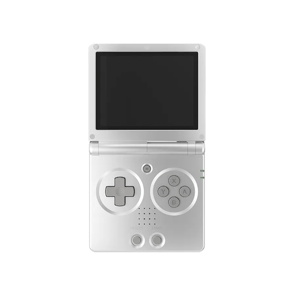

# rpgmaker-player

A native player for RPG Maker MV games, without the Chromium-based NW.js
player the games ship with. It is written for low-memory Linux handhelds
(reference device: Anbernic RG35XX SP, 1 GB RAM, muOS) and is also built for
Linux x86-64 and Android.

<!-- MOTIVATION (EN): put the GIF and the reason for this project here.
     The GIF is at docs/images/console-to-potato.gif, for example:
     
-->

**Status: experimental.** Two games have been played on the reference
console, Fear & Hunger and Fear & Hunger 2: Termina. Everything else is
untested. RPG Maker MZ games do not run.

## What it is

An MV game is a web page: the engine's scripts, the PIXI.js drawing library
and the game's plugins, loaded by a browser. On a 1 GB handheld that browser
does not fit, cannot reach the display, and is too slow where it does start.

The player keeps the game's JavaScript unchanged and replaces the browser
around it:

| Part | What it does | Where |
| --- | --- | --- |
| JavaScript engine | V8 12.4, embedded, with its JIT | `player/src/engine` |
| WebGL | The WebGL calls PIXI makes, passed on to OpenGL ES 2 | `player/src/bindings/webgl_binding.cpp` |
| Canvas 2D | Text and bitmap drawing, on Cairo and FreeType | `player/src/bindings/canvas_binding.cpp` |
| Sound | Own mixer on SDL2; Ogg Vorbis through stb_vorbis | `player/src/platform/audio_mixer.cpp` |
| Video | The system's `ffmpeg` program, read through pipes | `player/src/platform/video.cpp` |
| Window and input | SDL2: controllers, keyboard, touch | `player/src/platform` |
| Browser stand-in | The DOM, events, storage and Node pieces the engine asks for, in JavaScript | `player/js` |
| Patches | In-memory changes to the engine where its code is too costly | `player/patches` |

There is no browser, no DOM tree and no HTML layout inside it. Game files
are never edited: patches replace functions in memory after the game's own
scripts and plugins have loaded.

## Measured on the reference console

Anbernic RG35XX SP (Allwinner H700, Mali-G31, 640x480), muOS.

| | NW.js / browser engine | This player |
| --- | --- | --- |
| Memory, Fear & Hunger on a map | 750 MB, over 1 GB in battle | 220 to 275 MB |
| Lighting plugin, per logic step | about 40 ms on the CPU | drawn by the GPU |
| Fear & Hunger, large map | does not start | about 39 frames per second |
| Fear & Hunger 2, large map | does not start | 22 to 24 frames per second |

The numbers, how they were taken and their limits are in
`docs/designs/native-rpgmaker-mv-player.md`. The earlier feasibility
measurements are in `docs/history/feasibility-study.md`.

## What works

- MV games on the WebGL renderer, with their plugins, unchanged.
- Saves in the game's own format, in the game's `www/save` folder; a save
  made on a PC continues on the console.
- Encrypted images and sounds (`.rpgmvp`, `.rpgmvo`).
- Videos, where the system has `ffmpeg`.
- Controllers, keyboard and touch. A settings menu inside the game (menu
  button + X, or F1, or the MENU button on a touch screen): frame counter,
  which key each controller button presses, and an on-screen editor for
  the touch controls. Both are kept per game.
- A game list, to choose among the games found.

## What does not

- RPG Maker MZ.
- `.m4a` sound, encrypted or not.
- Video on Android (there is no `ffmpeg` program to start).
- Sound effects that rely on pitch or exact loop points are approximated.

## Installing and using

The player is distributed ready to run; nothing has to be compiled. Android
gets an APK (app stores later). The Linux packages are published by the
project itself. There is no public download page yet: until there is one,
the packages are built as described under "Building".

You need your own copy of a game. The player uses only the game's `www`
folder (the one with `index.html`), which the Windows and Linux downloads of
an MV game contain.

### Which package

A program built for one family of processors does not run on another, so
there is one package per family. On Linux, this command says which one a
machine has:

```sh
uname -m
```

| `uname -m` says | Machine | Package |
| --- | --- | --- |
| `x86_64` | PC or laptop with an Intel or AMD processor | `mvplayer-linux-x86_64.tar.gz` |
| `aarch64` | Handheld running muOS (Anbernic RG35XX family and alike) | `mvplayer-muos.tar.gz` |
| `aarch64` | Desktop Linux on 64-bit ARM: Raspberry Pi 4 or 5, ARM laptops and boards | `mvplayer-linux-aarch64.tar.gz` |
| `armv7l`, `armv6l`, `i686` | 32-bit systems | not supported |
| (Android) | Phone or tablet, 64-bit ARM, Android 8.0 or later | `mvplayer.apk` |

Two things decide whether a Linux package runs: the processor family above,
and the age of the system's C library (`ldd --version` shows it). The two
desktop packages need glibc 2.35 or newer (Ubuntu 22.04, Debian 12, Fedora
36); the muOS package needs 2.34. The two `aarch64` packages hold the same
program: the muOS one is laid out for that system's SD card and uses the
console's own libraries, the desktop one brings its libraries and a start
script. A 32-bit system on a 64-bit processor
(some Raspberry Pi installations) counts as 32-bit: `uname -m` may say
`aarch64` while the programs are `armhf`; `dpkg --print-architecture` must
say `arm64`.

On Android only 64-bit ARM devices (`arm64-v8a`) are supported, which is
nearly every phone sold since 2017. 32-bit-only phones and x86 devices
(some emulators and Chromebooks) are not.

### Android

1. Copy `mvplayer.apk` to the device and open it. Android asks to allow
   installing from this source the first time.
2. Start the app. It opens the system's "all files access" screen: allow it
   and open the app again. Without it the app cannot read the games folder.
3. Copy each game into the `RPGMV` folder at the top of the device's shared
   storage, one folder per game, each holding the game's `www` folder:
   `RPGMV/<Game>/www`. A file manager or a USB cable will do.
4. Choose the game from the list; the games played last come first. A game
   kept anywhere else on the device can be added with the list's "Add a
   game" line: go into the game's own folder and choose its `.exe`.

Without a controller, the screen shows a direction pad and three buttons.
The MENU button in the top right corner opens the settings; "TOUCH
CONTROLS" there moves, resizes, adds and removes buttons (a game that needs
the T key gets a T button). Back is cancel; held for a second it returns to
the list. Videos do not play on Android yet.

### Handhelds with muOS

1. Extract `mvplayer-muos.tar.gz` at the root of the SD card that holds the
   `MUOS` and `ROMS` folders, keeping the folder structure. It adds
   `MUOS/emulator/mvplayer`, `MUOS/application/RPG Maker MV` and
   `ROMS/RPGMV`.
2. Copy each game to `ROMS/RPGMV/<Game>/www` on the card. A game also runs
   from `/opt/mvplayer/games/<Game>/www` on internal storage, which loads
   faster.
3. On the console: Apps, then "RPG Maker MV". Choose the game with A; the
   games played last come first. A game kept in any other folder of the
   cards can be added with the list's "Add a game" line: go into the game's
   own folder and choose its `.exe`.

| Buttons | What they do |
| --- | --- |
| Menu, then Start | Leave the game, back to the list |
| Menu held + X | The player's settings: frame counter, which key each button presses |
| Menu held + Select | Show or hide the frames per second |

Videos use the `ffmpeg` that muOS already has.

### Desktop Linux (x86-64 and 64-bit ARM)

The steps are the same for both; only the archive differs. The 64-bit ARM
package has been run without a screen in a container, not yet on a real
ARM desktop.

1. Extract `mvplayer-linux-x86_64.tar.gz` or `mvplayer-linux-aarch64.tar.gz`
   anywhere and keep its files together.
2. Run `./mvplayer.sh`. The list's "Add a game" line shows your folders:
   go into the game's own folder and choose its `.exe` (or the `index.html`
   in its `www` folder). Games added are remembered, and the ones played
   last come first.
3. Optional: `./mvplayer.sh --install-launcher` adds the player to the
   desktop's application menu, and `./mvplayer.sh --check-libs` lists any
   system library that is missing.

Keys: arrows to move, Z or Enter to confirm, X or Esc to cancel, F1 for the
player's settings, F2 for the frames per second. A controller works too.
The player opens in a window that can be resized; F11 switches between the
window and the whole screen.
To see a game's videos, install `ffmpeg` with the system's package manager.
The package brings its own SDL2, Cairo and FreeType; details are in the
`README.txt` inside it.

## Patches

`player/patches/index.json` lists them and when each applies. All are
switched off with `--no-patches`, or per game by naming them under `"off"`
in the game's `save/mvplayer-patches.json`.

| Patch | Applies to | What it changes |
| --- | --- | --- |
| `gpuLights` | Games with the TerraxLighting plugin | The darkness mask is drawn by the GPU instead of the CPU |
| `eventCulling` | MV | Events far from the player are not updated on every step |
| `eventLookup` | MV | Looking up the events on a tile no longer scans every event |
| `preloadOnce` | MV | An event's images are asked for only the first time its command list starts |
| `framePacing` | MV | At most two logic steps per frame |
| `leanState` | MV | Writes that change nothing do not trigger a map refresh |
| `commonEventThrottle` | MV | Parallel common events that are pure checks, and cost enough, run once every six steps |
| `equipCache` | MV | An actor's equipment list is rebuilt only after a slot changed |

## Repository layout

```
player/
  src/engine/      V8 host: contexts, script loading, profiling
  src/bindings/    WebGL, Canvas 2D, audio and video, as seen from JavaScript
  src/platform/    window, input, sound mixer, video, files, settings menu
  js/              the browser stand-in and the game list
  patches/         the patches and their index
  packaging/       muOS, desktop Linux and Android packages
  tests/           native, JavaScript and on-device tests
  tools/           build scripts, V8 build, helpers
docs/designs/      the design document, with every result
docs/history/      the feasibility study and the experiments behind it
```

## Building

Builds run in containers; the images are described by the Dockerfiles in
`player/tools/build` and `player/tools/v8`. V8 is built once per target
(hours) and is not kept in git.

| Target | V8 | Player | Package |
| --- | --- | --- | --- |
| ARM64 Linux | `tools/v8/build.sh` | `tools/build/build.sh` | `packaging/muos/build-package.sh` (muOS), `packaging/linux/build-package.sh aarch64` (desktop) |
| Linux x86-64 | `tools/v8/build-x64.sh` | `tools/build/build-x64.sh` | `packaging/linux/build-package.sh x86_64` |
| Android (arm64-v8a) | `tools/v8/build-android.sh` | `tools/build/build-android-deps.sh`, then `tools/build/build-android.sh` | `packaging/android/build-apk.sh` |

For example, the console build, from the repository's root:

```sh
docker run --rm -v "$PWD/player":/work/player mvp-player-build sh /work/player/tools/build/build.sh
```

Each package has its own notes: `player/packaging/android/README.md`,
`player/packaging/linux/README.txt`.

## Running

```sh
mvplayer --game <path>                 # a game: its www folder, the folder holding it, or its .exe
mvplayer --pick <games-dir> [...]      # the game list
mvplayer --game <path> --run <script>  # with a watch script, for tests
```

`--fps` starts with the frame counter on; `--no-patches` runs without the
patches. The log of a run is the game's `www/save/mvplayer.log`.

Where games go on each platform is under "Installing and using".

## Tests

```sh
# Native tests, in the build image
docker run --rm -v "$PWD/player":/work/player mvp-player-build sh /work/player/tools/build/test.sh

# JavaScript tests, with Node
for t in player/tests/js/*.test.js player/tests/patches/*.test.js; do node "$t"; done
```

`player/tests/device` holds scripts that run next to a real game on the
console (`--run`) and log measurements: a walk, a battle, a video, the cost
of each common event.

## Game files

No game data, engine scripts or plugins are included, and none may be
committed. Use your own copy of a game.

## License

GPL-3.0-or-later: see `LICENSE`. The license covers the player only; games,
their engine scripts and their plugins belong to their own authors.

The player links against V8 (BSD 3-Clause), SDL2 (zlib), Cairo (LGPL 2.1 or
MPL 1.1), pixman (MIT), FreeType (FTL), libpng and stb_vorbis (public domain
or MIT), and starts `ffmpeg` as a separate program.

---

# rpgmaker-player (español)

Un reproductor nativo de juegos de RPG Maker MV, sin el reproductor NW.js
basado en Chromium con el que se distribuyen. Está escrito para consolas
Linux con poca memoria (dispositivo de referencia: Anbernic RG35XX SP, 1 GB
de RAM, muOS) y se compila también para Linux x86-64 y Android.

<!-- MOTIVACIÓN (ES): aquí van el GIF y el porqué de este proyecto.
     El GIF está en docs/images/console-to-potato.gif, por ejemplo:
     
-->

**Estado: experimental.** En la consola de referencia se ha jugado a dos
juegos, Fear & Hunger y Fear & Hunger 2: Termina. Todo lo demás está sin
probar. Los juegos de RPG Maker MZ no funcionan.

## Qué es

Un juego de MV es una página web: los scripts del motor, la librería de
dibujo PIXI.js y los plugins del juego, cargados por un navegador. En una
consola de 1 GB ese navegador no cabe, no puede usar la pantalla y, donde
arranca, va demasiado lento.

El reproductor deja el JavaScript del juego tal cual y sustituye el
navegador que lo rodea:

| Parte | Qué hace | Dónde |
| --- | --- | --- |
| Motor de JavaScript | V8 12.4, embebido, con su JIT | `player/src/engine` |
| WebGL | Las llamadas WebGL que hace PIXI, pasadas a OpenGL ES 2 | `player/src/bindings/webgl_binding.cpp` |
| Canvas 2D | Texto y dibujo de mapas de bits, sobre Cairo y FreeType | `player/src/bindings/canvas_binding.cpp` |
| Sonido | Mezclador propio sobre SDL2; Ogg Vorbis con stb_vorbis | `player/src/platform/audio_mixer.cpp` |
| Vídeo | El programa `ffmpeg` del sistema, leído por tuberías | `player/src/platform/video.cpp` |
| Ventana y entrada | SDL2: mandos, teclado, pantalla táctil | `player/src/platform` |
| Sustituto del navegador | El DOM, los eventos, el almacenamiento y las piezas de Node que pide el motor, en JavaScript | `player/js` |
| Parches | Cambios en memoria al motor donde su código cuesta demasiado | `player/patches` |

Dentro no hay navegador, ni árbol DOM, ni maquetación HTML. Los archivos
del juego no se modifican nunca: los parches sustituyen funciones en
memoria una vez cargados los scripts y plugins del juego.

## Medido en la consola de referencia

Anbernic RG35XX SP (Allwinner H700, Mali-G31, 640x480), muOS.

| | NW.js / motor de navegador | Este reproductor |
| --- | --- | --- |
| Memoria, Fear & Hunger en un mapa | 750 MB, más de 1 GB en combate | de 220 a 275 MB |
| Plugin de luces, por paso de lógica | unos 40 ms en la CPU | lo dibuja la GPU |
| Fear & Hunger, mapa grande | no arranca | unos 39 fotogramas por segundo |
| Fear & Hunger 2, mapa grande | no arranca | de 22 a 24 fotogramas por segundo |

Las cifras, cómo se tomaron y sus límites están en
`docs/designs/native-rpgmaker-mv-player.md` (en inglés). Las mediciones de
viabilidad anteriores están en `docs/history/feasibility-study.md`.

## Qué funciona

- Juegos de MV con el renderizador WebGL, con sus plugins, sin tocarlos.
- Partidas en el formato del propio juego, en su carpeta `www/save`; una
  partida guardada en un PC continúa en la consola.
- Imágenes y sonidos cifrados (`.rpgmvp`, `.rpgmvo`).
- Vídeos, donde el sistema tenga `ffmpeg`.
- Mandos, teclado y pantalla táctil. Un menú de ajustes dentro del juego
  (botón menú + X, o F1, o el botón MENU en pantalla táctil): contador de
  fotogramas, qué tecla pulsa cada botón del mando y un editor en pantalla
  de los controles táctiles. Ambos se guardan por juego.
- Una lista de juegos para elegir entre los encontrados.

## Qué no

- RPG Maker MZ.
- Sonido `.m4a`, cifrado o no.
- Vídeo en Android (no hay programa `ffmpeg` que arrancar).
- Los efectos de sonido que dependen del tono o de puntos de bucle exactos
  se aproximan.

## Instalar y usar

El reproductor se distribuye listo para ejecutar; no hay que compilar nada.
Para Android hay un APK (más adelante, en las tiendas). Los paquetes de
Linux los publica el propio proyecto. Todavía no hay página pública de
descargas: hasta que la haya, los paquetes se generan como se explica en
"Compilar".

Hace falta tu propia copia del juego. El reproductor solo usa la carpeta
`www` del juego (la que tiene `index.html`), que viene en las descargas
para Windows y para Linux de un juego de MV.

### Qué paquete

Un programa compilado para una familia de procesadores no funciona en otra,
así que hay un paquete por familia. En Linux, este comando dice cuál tiene
una máquina:

```sh
uname -m
```

| `uname -m` dice | Máquina | Paquete |
| --- | --- | --- |
| `x86_64` | PC o portátil con procesador Intel o AMD | `mvplayer-linux-x86_64.tar.gz` |
| `aarch64` | Consola con muOS (familia Anbernic RG35XX y parecidas) | `mvplayer-muos.tar.gz` |
| `aarch64` | Linux de escritorio en ARM de 64 bits: Raspberry Pi 4 o 5, portátiles y placas ARM | `mvplayer-linux-aarch64.tar.gz` |
| `armv7l`, `armv6l`, `i686` | Sistemas de 32 bits | no soportado |
| (Android) | Móvil o tableta, ARM de 64 bits, Android 8.0 o posterior | `mvplayer.apk` |

Dos cosas deciden si un paquete de Linux funciona: la familia de procesador
de la tabla y la antigüedad de la biblioteca de C del sistema (la muestra
`ldd --version`). Los dos paquetes de escritorio necesitan glibc 2.35 o
posterior (Ubuntu 22.04, Debian 12, Fedora 36); el de muOS, 2.34. Los dos
paquetes `aarch64` llevan el mismo programa: el de muOS va dispuesto para
la tarjeta SD de ese sistema y usa las bibliotecas de la consola; el de
escritorio trae sus bibliotecas y un script de arranque.
Un sistema de 32 bits sobre un procesador de 64 (algunas instalaciones de
Raspberry Pi) cuenta como 32 bits: `uname -m` puede decir `aarch64` y los
programas ser `armhf`; `dpkg --print-architecture` tiene que decir `arm64`.

En Android solo valen los dispositivos ARM de 64 bits (`arm64-v8a`), que
son casi todos los móviles vendidos desde 2017. Los móviles solo de 32 bits
y los dispositivos x86 (algunos emuladores y Chromebooks) no.

### Android

1. Copia `mvplayer.apk` al dispositivo y ábrelo. La primera vez, Android
   pide permiso para instalar desde ese origen.
2. Abre la app. Muestra la pantalla del sistema de "acceso a todos los
   archivos": permítelo y vuelve a abrir la app. Sin eso no puede leer la
   carpeta de juegos.
3. Copia cada juego a la carpeta `RPGMV`, en la raíz del almacenamiento
   compartido, una carpeta por juego con su `www` dentro:
   `RPGMV/<Juego>/www`. Sirve un gestor de archivos o un cable USB.
4. Elige el juego en la lista; los últimos jugados salen primero. Un juego
   guardado en cualquier otro sitio del dispositivo se añade con la línea
   "Add a game" de la lista: entra en la carpeta del juego y elige su
   `.exe`.

Sin mando, la pantalla muestra una cruceta y tres botones. El botón MENU,
arriba a la derecha, abre los ajustes; "TOUCH CONTROLS" permite mover,
cambiar de tamaño, añadir y quitar botones (un juego que necesita la tecla
T recibe un botón T). Atrás es cancelar; mantenido un segundo vuelve a la
lista. En Android todavía no se reproducen vídeos.

### Consolas con muOS

1. Extrae `mvplayer-muos.tar.gz` en la raíz de la tarjeta SD que contiene
   las carpetas `MUOS` y `ROMS`, conservando la estructura de carpetas.
   Añade `MUOS/emulator/mvplayer`, `MUOS/application/RPG Maker MV` y
   `ROMS/RPGMV`.
2. Copia cada juego a `ROMS/RPGMV/<Juego>/www` en la tarjeta. Un juego
   también funciona desde `/opt/mvplayer/games/<Juego>/www`, en el
   almacenamiento interno, donde carga más rápido.
3. En la consola: Apps y después "RPG Maker MV". Elige el juego con A; los
   últimos jugados salen primero. Un juego guardado en cualquier otra
   carpeta de las tarjetas se añade con la línea "Add a game" de la lista:
   entra en la carpeta del juego y elige su `.exe`.

| Botones | Qué hacen |
| --- | --- |
| Menú y después Start | Salir del juego, de vuelta a la lista |
| Menú mantenido + X | Ajustes del reproductor: contador de fotogramas, qué tecla pulsa cada botón |
| Menú mantenido + Select | Mostrar u ocultar los fotogramas por segundo |

Los vídeos usan el `ffmpeg` que muOS ya trae.

### Linux de escritorio (x86-64 y ARM de 64 bits)

Los pasos son los mismos para los dos; solo cambia el archivo. El paquete
ARM de 64 bits se ha ejecutado sin pantalla en un contenedor, todavía no en
un escritorio ARM real.

1. Extrae `mvplayer-linux-x86_64.tar.gz` o `mvplayer-linux-aarch64.tar.gz`
   donde quieras y mantén sus archivos juntos.
2. Ejecuta `./mvplayer.sh`. La línea "Add a game" de la lista muestra tus
   carpetas: entra en la carpeta del juego y elige su `.exe` (o el
   `index.html` de su carpeta `www`). Los juegos añadidos se recuerdan, y
   los últimos jugados salen primero.
3. Opcional: `./mvplayer.sh --install-launcher` añade el reproductor al
   menú de aplicaciones del escritorio, y `./mvplayer.sh --check-libs`
   enumera las bibliotecas del sistema que falten.

Teclas: flechas para moverse, Z o Intro para confirmar, X o Esc para
cancelar, F1 para los ajustes del reproductor, F2 para los fotogramas por
segundo. También funciona un mando. El reproductor se abre en una ventana
que se puede redimensionar; F11 alterna entre la ventana y la pantalla
completa. Para ver los vídeos de un juego,
instala `ffmpeg` con el gestor de paquetes del sistema. El paquete trae sus
propias SDL2, Cairo y FreeType; los detalles están en el `README.txt` que
lleva dentro (en inglés).

## Parches

`player/patches/index.json` los enumera y dice cuándo se aplica cada uno.
Se apagan todos con `--no-patches`, o por juego nombrándolos bajo `"off"`
en el `save/mvplayer-patches.json` del juego.

| Parche | Se aplica a | Qué cambia |
| --- | --- | --- |
| `gpuLights` | Juegos con el plugin TerraxLighting | La máscara de oscuridad la dibuja la GPU en lugar de la CPU |
| `eventCulling` | MV | Los eventos lejos del jugador no se actualizan en cada paso |
| `eventLookup` | MV | Buscar los eventos de una casilla ya no recorre todos los eventos |
| `preloadOnce` | MV | Las imágenes de un evento se piden solo la primera vez que arranca su lista de comandos |
| `framePacing` | MV | Como mucho dos pasos de lógica por fotograma |
| `leanState` | MV | Las escrituras que no cambian nada no provocan un refresco del mapa |
| `commonEventThrottle` | MV | Los eventos comunes paralelos que son comprobaciones puras, y cuestan lo bastante, se ejecutan una vez cada seis pasos |
| `equipCache` | MV | La lista de equipo de un personaje solo se rehace cuando cambia un hueco |

## Estructura del repositorio

```
player/
  src/engine/      anfitrión de V8: contextos, carga de scripts, perfilado
  src/bindings/    WebGL, Canvas 2D, sonido y vídeo, vistos desde JavaScript
  src/platform/    ventana, entrada, mezclador, vídeo, archivos, menú de ajustes
  js/              el sustituto del navegador y la lista de juegos
  patches/         los parches y su índice
  packaging/       paquetes para muOS, Linux de escritorio y Android
  tests/           pruebas nativas, de JavaScript y en la consola
  tools/           scripts de compilación, compilación de V8, utilidades
docs/designs/      el documento de diseño, con todos los resultados
docs/history/      el estudio de viabilidad y sus experimentos
```

## Compilar

Las compilaciones se hacen en contenedores; las imágenes están descritas en
los Dockerfile de `player/tools/build` y `player/tools/v8`. V8 se compila
una vez por plataforma (horas) y no se guarda en git.

| Plataforma | V8 | Reproductor | Paquete |
| --- | --- | --- | --- |
| Linux ARM64 | `tools/v8/build.sh` | `tools/build/build.sh` | `packaging/muos/build-package.sh` (muOS), `packaging/linux/build-package.sh aarch64` (escritorio) |
| Linux x86-64 | `tools/v8/build-x64.sh` | `tools/build/build-x64.sh` | `packaging/linux/build-package.sh x86_64` |
| Android (arm64-v8a) | `tools/v8/build-android.sh` | `tools/build/build-android-deps.sh` y después `tools/build/build-android.sh` | `packaging/android/build-apk.sh` |

Por ejemplo, la compilación para la consola, desde la raíz del repositorio:

```sh
docker run --rm -v "$PWD/player":/work/player mvp-player-build sh /work/player/tools/build/build.sh
```

Cada paquete tiene sus propias notas (en inglés):
`player/packaging/android/README.md`, `player/packaging/linux/README.txt`.

## Ejecutar

```sh
mvplayer --game <ruta>                 # un juego: su carpeta www, la que la contiene o su .exe
mvplayer --pick <carpeta-juegos> [...] # la lista de juegos
mvplayer --game <ruta> --run <script>  # con un script de observación, para pruebas
```

`--fps` arranca con el contador de fotogramas; `--no-patches` ejecuta sin
los parches. El registro de cada ejecución es el `www/save/mvplayer.log`
del juego.

Dónde van los juegos en cada plataforma está en "Instalar y usar".

## Pruebas

```sh
# Pruebas nativas, en la imagen de compilación
docker run --rm -v "$PWD/player":/work/player mvp-player-build sh /work/player/tools/build/test.sh

# Pruebas de JavaScript, con Node
for t in player/tests/js/*.test.js player/tests/patches/*.test.js; do node "$t"; done
```

`player/tests/device` contiene scripts que se ejecutan junto a un juego
real en la consola (`--run`) y registran mediciones: un paseo, un combate,
un vídeo, el coste de cada evento común.

## Archivos del juego

No se incluyen datos de ningún juego, ni scripts del motor, ni plugins, y
no deben subirse. Usa tu propia copia del juego.

## Licencia

GPL-3.0-or-later: véase `LICENSE`. La licencia cubre solo el reproductor;
los juegos, los scripts de su motor y sus plugins son de sus autores.

El reproductor se enlaza con V8 (BSD de 3 cláusulas), SDL2 (zlib), Cairo
(LGPL 2.1 o MPL 1.1), pixman (MIT), FreeType (FTL), libpng y stb_vorbis
(dominio público o MIT), y arranca `ffmpeg` como programa aparte.
