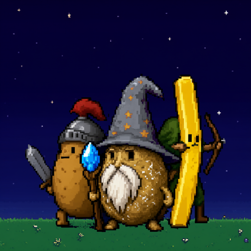
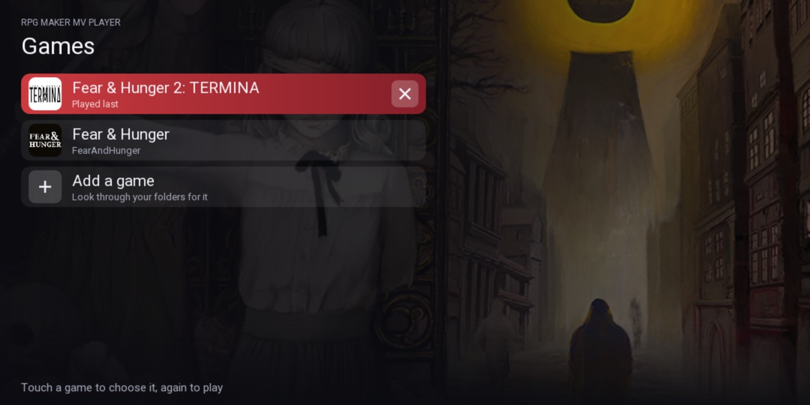
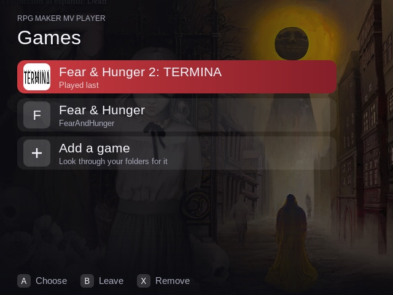

# RPGM-PP



**Potato Player**, the RPG Maker Potato Player.

A native player for RPG Maker MV and MZ games, without the Chromium-based NW.js
player the games ship with. It is written for low-memory Linux handhelds
(reference device: Anbernic RG35XX SP, 1 GB RAM, muOS) and is also built for
desktop Linux (x86-64 and 64-bit ARM) and Android. Ready-made packages are
on the [releases page](https://github.com/Mazer-R/RPGM-PP/releases/latest);
[Installing and using](#installing-and-using) says how to install each.


**Why.** I wanted to play RPG Maker games on my Anbernic RG35XX, and could
not: the Chromium wrapper the games come with ate all of the console's
memory. Through other systems the games did start, but they could not be
played: 5 frames per second at most.

**Status: experimental.** Four games have been played on the reference
console, none of them to the end: two made with MV, Fear & Hunger and
Fear & Hunger 2: Termina, and two made with MZ, Look Outside and a small
free game. The player has been tried on one Android phone and on one
desktop PC. Other games are untested, and the 64-bit ARM desktop package
has not been tried on a real machine yet. MZ is the newer of the two: see
[What does not](#what-does-not).



*The game list on an Android phone .



*The same list on the reference console (Anbernic RG35XX SP, 640x480).*

## What it is

An MV game is a web page: the engine's scripts, the PIXI.js drawing library
and the game's plugins, loaded by a browser. On a 1 GB handheld that browser
does not fit, cannot reach the display, and is too slow where it does start.

The player keeps the game's JavaScript unchanged and replaces the browser
around it:

| Part | What it does | Where |
| --- | --- | --- |
| JavaScript engine | V8 12.4, embedded, with its JIT | `player/src/engine` |
| WebGL | The WebGL calls PIXI makes, passed on to OpenGL ES 2 | `player/src/bindings/webgl_binding.cpp` |
| Canvas 2D | Text and bitmap drawing, on Cairo and FreeType | `player/src/bindings/canvas_binding.cpp` |
| Sound | Own mixer on SDL2; Ogg Vorbis through stb_vorbis | `player/src/platform/audio_mixer.cpp` |
| Video | The `ffmpeg` program (the system's; on Android one inside the app), read through pipes | `player/src/platform/video.cpp` |
| Window and input | SDL2: controllers, keyboard, touch | `player/src/platform` |
| Browser stand-in | The DOM, events, storage and Node pieces the engine asks for, in JavaScript | `player/js` |
| Patches | In-memory changes to the engine where its code is too costly | `player/patches` |

There is no browser, no DOM tree and no HTML layout inside it. Game files
are never edited: patches replace functions in memory after the game's own
scripts and plugins have loaded.

## Measured on the reference console

Anbernic RG35XX SP (Allwinner H700, Mali-G31, 640x480), muOS.

| | NW.js / browser engine | This player |
| --- | --- | --- |
| Memory, Fear & Hunger on a map | 750 MB, over 1 GB in battle | 220 to 275 MB |
| Lighting plugin, per logic step | about 40 ms on the CPU | drawn by the GPU |
| Fear & Hunger, large map | does not start | about 39 frames per second |
| Fear & Hunger 2, large map | does not start | 22 to 24 frames per second |

The numbers, how they were taken and their limits are in
`docs/designs/native-rpgmaker-mv-player.md`. The earlier feasibility
measurements are in `docs/history/feasibility-study.md`.

## What works

- MV games on the WebGL renderer, with their plugins, unchanged.
- MZ games, with their plugins, unchanged, WebAssembly included.
- Saves in the game's own format, in the game's `www/save` folder (`save`
  in an MZ game); a save made on a PC continues on the console.
- Encrypted images and sounds (`.rpgmvp`, `.rpgmvo`).
- Videos, where the system has `ffmpeg`; the Android app brings its own.
  A video the game draws itself, as a background or a picture, is shown
  too.
- Touches and the mouse reach the game, for games played by pointing; the
  on-screen controls can be switched off.
- Controllers, keyboard and touch. A settings menu inside the game (menu
  button + X, or F1, or the MENU button on a touch screen): frame counter,
  which key each controller button presses, and an on-screen editor for
  the touch controls. Both are kept per game.
- A game list, to choose among the games found, add others, and take off
  the ones you no longer want (their files are not deleted).
- A profile, from the game list: a name and a potato avatar to dress.
  More characters and pieces are won by using the player. Kept on the
  device, with no account.

## What does not

- MZ games are less tried than MV ones: one showed its dialogue text
  twice, and the patches that make MV faster are mostly not written for
  MZ yet.
- A video drawn as a background costs frames on the console: about 30 per
  second in the one scene measured.
- `.m4a` sound, encrypted or not.
- Sound effects that rely on pitch or exact loop points are approximated.

## Installing and using

The player is distributed ready to run; nothing has to be compiled.

You need your own copy of a game. The player uses only the folder with the
game's `index.html`: the `www` folder of an MV game, or the game's own
folder for an MZ game, which has no `www`. The Windows and Linux downloads
of a game contain it. Copy the whole game folder: the list also finds a
game by its `.exe`. Where the steps below say `<Game>/www`, an MZ game is
just `<Game>`.

### Download

The packages are on the project's releases page:
<https://github.com/Mazer-R/RPGM-PP/releases/latest>

**Coming from version 0.2 or earlier.** Up to 0.2 the program's files and
folders were called `mvplayer`; from 0.3 they are called `potato-player`,
and the Android app has a new identifier. A newer package no longer
updates an older one: it installs beside it. The games and their saves
are not touched. To keep the list of games and the profile, rename the
old folder before the first start, and then remove what is left of the
old version:

| System | Rename | Remove |
| --- | --- | --- |
| Android | `RPGMV/mvplayer` to `RPGMV/potato-player`, in the shared storage | The old "Potato Player" app |
| muOS | `MUOS/emulator/mvplayer` to `MUOS/emulator/potato-player`, then extract the new archive over it | Nothing: the Apps entry is replaced |
| Desktop Linux | `~/.config/mvplayer` to `~/.config/potato-player` | The old folder, and `~/.local/share/applications/mvplayer.desktop` if the launcher was installed |

What was switched off for one game is in that game's
`save/mvplayer-patches.json`: rename it to `potato-player-patches.json`
to keep it.

| System | File |
| --- | --- |
| Android phone or tablet (64-bit ARM, Android 8.0 or later) | `potato-player-android-arm64.apk` |
| Handheld with muOS (Anbernic RG35XX family and alike) | `potato-player-muos.tar.gz` |
| Desktop Linux, Intel or AMD processor | `potato-player-linux-x86_64.tar.gz` |
| Desktop Linux, 64-bit ARM (Raspberry Pi 4 or 5, ARM laptops and boards) | `potato-player-linux-aarch64.tar.gz` |

### Android

1. Download `potato-player-android-arm64.apk` on the device (or copy it there)
   and open it from the file manager. The first time, Android asks to allow
   installing from that app: allow it and go back. The app is not in any
   store and is signed with a test key, so Play Protect may ask once more.
   With a computer and USB debugging the same is done with
   `adb install -r potato-player-android-arm64.apk`.
2. Start "Potato Player". It asks for nothing. Without any permission it
   plays the games in its own folder,
   `Android/data/org.potatoplayer/files/games/<Game>/www`, which current
   Android versions let a computer fill over USB but hardly any file
   manager on the device.
3. To keep games anywhere else, choose "Add a game" and then "Look in all
   folders": the app opens the system's "all files access" screen. Allow
   it and open the app again. From then on the app also looks in the
   `RPGMV` folder at the top of the shared storage, one folder per game,
   each holding the game's `www` folder: `RPGMV/<Game>/www`. Copy games
   there with a USB cable or a file manager. Android has no smaller
   permission that lets a program read a folder's files by their paths.
4. Touch a game to choose it and touch it again to start it; the games
   played last come first. A game kept anywhere else on the device is added
   with the list's "Add a game" line: go into the game's own folder and
   choose its `.exe`. To take a game off the list, choose it and touch the
   cross at the end of its line, then touch it again to confirm; its files
   stay where they are.

Without a controller, the screen shows three buttons, and a stick that
appears under your thumb anywhere on the left half: pull it to move, in
eight directions where the game has them. The MENU button in the top right
corner opens the settings: "MOVE" there swaps the stick for a round pad
that stays in place, and "TOUCH CONTROLS" moves, resizes, adds and removes
buttons (a game that needs
the T key gets a T button). Back is cancel; held for a second it returns to
the list. Videos are decoded by an `ffmpeg` that comes inside the app.

A touch on none of these controls goes to the game itself, where the game
takes touches: to walk to a place on the map, or to choose from a menu.
With the stick that is the right half of the screen; with the pad, all of
it. A game that switches the mouse off ignores these touches too. For a
game played entirely by touch, "CONTROLS" in the settings takes the stick
and the buttons off the screen; the MENU button stays, to bring them back.
The list of games is shown with the phone upright; a game turns the screen
on its side.

To update, install the newer APK over the old one; games, saves and
settings are kept. To remove the player, uninstall the app; the `RPGMV`
folder, with the games and their saves, stays until you delete it.

### Handhelds with muOS

The package is extracted onto the SD card that holds the `MUOS` and `ROMS`
folders (the first card), at its top level. It adds
`MUOS/emulator/potato-player`, `MUOS/application/Potato Player` and `ROMS/RPGMV`,
and touches nothing else.

1. Switch the console off, take the card out and put it in a computer.
2. Extract the archive at the card's top level, so that its `MUOS` and
   `ROMS` folders merge with the ones already there. On Linux or macOS,
   with the card's own path in place of `/path/to/card`:

   ```sh
   tar -xzf potato-player-muos.tar.gz -C /path/to/card
   ```

   On Windows, 7-Zip opens the archive (twice: the `.gz`, then the `.tar`
   inside); drag the `MUOS` and `ROMS` folders onto the card and accept
   merging the folders.
3. Copy each game to `ROMS/RPGMV/<Game>/www` on the card.
4. Put the card back and start the console: Apps, then "Potato Player".
   Choose a game with A; the games played last come first. A game kept in
   any other folder of the cards is added with the list's "Add a game"
   line: go into the game's own folder and choose its `.exe`. X takes the
   chosen game off the list (press X again to confirm, B to keep it); its
   files stay on the card.

With SSH enabled on the console, the same archive can be copied over the
network and extracted there with
`gzip -dc potato-player-muos.tar.gz | tar -x -C /mnt/mmc` (the console's `tar`
does not read `.gz` by itself). A game also runs from `/opt/potato-player/games/<Game>/www` on
internal storage, which loads faster.

| Buttons | What they do |
| --- | --- |
| Menu held + Start | Leave the game, back to the list |
| Menu held + X | The player's settings: frame counter, which key each button presses, and a pointer for games made for the mouse |
| Menu held + Select | Show or hide the frames per second |

Videos use the `ffmpeg` that muOS already has.

To update, extract the newer archive over the old one; the list of games
and the saves are kept. To remove the player, delete
`MUOS/emulator/potato-player` and `MUOS/application/Potato Player` from the card.
Version 0.1 was listed as "RPG Maker MV": when updating from it, delete
`MUOS/application/RPG Maker MV` too, or the Apps menu shows both.

### Desktop Linux (x86-64 and 64-bit ARM)

The steps are the same for both; only the archive differs. The x86-64
package has been tried on a desktop PC; the 64-bit ARM one has only been
run in a container, without a screen. Both need glibc 2.35 or newer (Ubuntu
22.04, Debian 12, Fedora 36, or later).

1. Extract the archive anywhere in your home folder and go into it:

   ```sh
   tar -xzf potato-player-linux-x86_64.tar.gz
   cd potato-player-linux-x86_64
   ```

2. Check that the system has the libraries the player expects; it lists
   any that are missing, to install with the system's package manager:

   ```sh
   ./potato-player.sh --check-libs
   ```

3. Start it:

   ```sh
   ./potato-player.sh
   ```

   The list's "Add a game" line shows your folders: go into the game's own
   folder and choose its `.exe` (or the `index.html` in its `www` folder).
   Games added are remembered, and the ones played last come first. Delete
   (or X on a controller, or the cross at the end of the chosen line with
   the mouse) takes a game off the list, after asking again; its files
   stay where they are. A game can also be started directly:
   `./potato-player.sh "/path/to/the game/Game.exe"`.
4. Optional: `./potato-player.sh --install-launcher` adds "Potato Player"
   to the desktop's application menu.
5. Optional, for a game's videos: install `ffmpeg` with the system's
   package manager (`sudo apt install ffmpeg`, `sudo dnf install ffmpeg`,
   `sudo pacman -S ffmpeg`). Without it a game goes on as if each video had
   ended at once.

Keys: arrows to move, Z or Enter to confirm, X or Esc to cancel, F1 for the
player's settings, F2 for the frames per second. A controller works too,
and so does the mouse where the game takes it: the left button presses,
the right one cancels.
The player opens in a window that can be resized; F11 switches between the
window and the whole screen. The package brings its own SDL2, Cairo and
FreeType and keeps its files together: always start it through
`potato-player.sh`. More details are in the `README.txt` inside it.

To update, extract the newer archive in place of the old folder; the list
of games is kept in `~/.config/potato-player/games.txt` and the saves in each
game's `www/save`. To remove the player, delete its folder, that file and,
if the launcher was installed, `~/.local/share/applications/potato-player.desktop`.

## Patches

`player/patches/index.json` lists them and when each applies. All are
switched off with `--no-patches`, or per game by naming them under `"off"`
in the game's `save/potato-player-patches.json`.

| Patch | Applies to | What it changes |
| --- | --- | --- |
| `gpuLights` | Games with the TerraxLighting plugin | The darkness mask is drawn by the GPU instead of the CPU |
| `eventCulling` | MV | Events far from the player are not updated on every step |
| `eventLookup` | MV | Looking up the events on a tile no longer scans every event |
| `preloadOnce` | MV | An event's images are asked for only the first time its command list starts |
| `framePacing` | MV | At most two logic steps per frame |
| `leanState` | MV | Writes that change nothing do not trigger a map refresh |
| `commonEventThrottle` | MV | Parallel common events that are pure checks, and cost enough, run once every six steps |
| `equipCache` | MV | An actor's equipment list is rebuilt only after a slot changed |
| `idleColorFilters` | MZ | A colour filter that changes nothing is not run |
| `windowClip` | MZ | A window's contents are clipped with a rectangle instead of a filter |
| `leanTint` | MV | A sprite's flash or tone is worked out without the fills that change nothing |
| `idleToneFilter` | MV | The screen's tone filter is off while there is no tone |
| `idleBattleLayers` | MV | A battle's empty backgrounds, and the picture of the map behind a solid one, are not drawn |
| `renderAfterClockStep` | MV | The picture is drawn again after the system sets its clock back in the middle of a drawing (without it the game runs on but the screen never changes again) |
| `pictureScale` | MV | On a screen smaller than the game, pictures shown whole are kept in the graphics memory at the size the screen shows |
| `textureBudget` | MV, MZ | Textures not drawn lately are dropped when they take more than a share of the device's memory |

## Repository layout

```
player/
  src/engine/      V8 host: contexts, script loading, profiling
  src/bindings/    WebGL, Canvas 2D, audio and video, as seen from JavaScript
  src/platform/    window, input, sound mixer, video, files, settings menu
  js/              the browser stand-in and the game list
  patches/         the patches and their index
  packaging/       muOS, desktop Linux and Android packages
  tests/           native, JavaScript and on-device tests
  tools/           build scripts, V8 build, helpers
docs/designs/      the design document, with every result
docs/history/      the feasibility study and the experiments behind it
```

## Building

Builds run in containers; the images are described by the Dockerfiles in
`player/tools/build` and `player/tools/v8`. V8 is built once per target
(hours) and is not kept in git.

| Target | V8 | Player | Package |
| --- | --- | --- | --- |
| ARM64 Linux | `tools/v8/build.sh` | `tools/build/build.sh` | `packaging/muos/build-package.sh` (muOS), `packaging/linux/build-package.sh aarch64` (desktop) |
| Linux x86-64 | `tools/v8/build-x64.sh` | `tools/build/build-x64.sh` | `packaging/linux/build-package.sh x86_64` |
| Android (arm64-v8a) | `tools/v8/build-android.sh` | `tools/build/build-android-deps.sh`, `tools/build/build-android-ffmpeg.sh`, then `tools/build/build-android.sh` | `packaging/android/build-apk.sh` |

For example, the console build, from the repository's root:

```sh
docker run --rm -v "$PWD/player":/work/player mvp-player-build sh /work/player/tools/build/build.sh
```

Each package has its own notes: `player/packaging/android/README.md`,
`player/packaging/linux/README.txt`.

## Running

```sh
potato-player --game <path>                 # a game: its www folder, the folder holding it, or its .exe
potato-player --pick <games-dir> [...]      # the game list
potato-player --game <path> --run <script>  # with a watch script, for tests
```

`--fps` starts with the frame counter on; `--no-patches` runs without the
patches. The log of a run is the game's `www/save/potato-player.log`.

Where games go on each platform is under "Installing and using".

## Tests

```sh
# Native tests, in the build image
docker run --rm -v "$PWD/player":/work/player mvp-player-build sh /work/player/tools/build/test.sh

# JavaScript tests, with Node
for t in player/tests/js/*.test.js player/tests/patches/*.test.js; do node "$t"; done
```

`player/tests/device` holds scripts that run next to a real game on the
console (`--run`) and log measurements: a walk, a battle, a video, the cost
of each common event.

## Game files

No game data, engine scripts or plugins are included, and none may be
committed. Use your own copy of a game.

## License

GPL-3.0-or-later: see `LICENSE`. The license covers the player only; games,
their engine scripts and their plugins belong to their own authors.

The player links against V8 (BSD 3-Clause), SDL2 (zlib), Cairo (LGPL 2.1 or
MPL 1.1), pixman (MIT), FreeType (FTL), libpng and stb_vorbis (public domain
or MIT), and starts `ffmpeg` as a separate program. The Android package
carries a build of FFmpeg (LGPL 2.1 or later) for that.

## Thanks

To Miro Haverinen, the creator of Fear & Hunger, for inspiring me to build
this so that I could play his games.

---

# RPGM-PP (español)


**Potato Player**, the RPG Maker Potato Player.

Un reproductor nativo de juegos de RPG Maker MV y MZ, sin el reproductor NW.js
basado en Chromium con el que se distribuyen. Está escrito para consolas
Linux con poca memoria (dispositivo de referencia: Anbernic RG35XX SP, 1 GB
de RAM, muOS) y se compila también para Linux de escritorio (x86-64 y ARM de
64 bits) y Android. Los paquetes ya compilados están en la
[página de versiones](https://github.com/Mazer-R/RPGM-PP/releases/latest);
[Instalar y usar](#instalar-y-usar) explica cómo instalar cada uno.


**Por qué.** Quería jugar a juegos de RPG Maker en mi Anbernic RG35XX y no
podía: el envoltorio de Chromium con el que vienen los juegos se comía toda
la memoria de la consola. Con otros sistemas los juegos arrancaban, pero
eran injugables: 5 fotogramas por segundo como mucho.

**Estado: experimental.** En la consola de referencia se ha jugado a
cuatro juegos, ninguno hasta el final: dos hechos con MV, Fear & Hunger y
Fear & Hunger 2: Termina, y dos hechos con MZ, Look Outside y un juego
gratuito pequeño. El reproductor se ha probado en un móvil Android y en un
PC de escritorio. Los demás juegos están sin probar, y el paquete de
escritorio para ARM de 64 bits no se ha probado todavía en una máquina
real. MZ es el más reciente de los dos: mira [Qué no](#qué-no).


*La lista de juegos en un móvil Android.*


*La misma lista en la consola de referencia (Anbernic RG35XX SP, 640x480).*

## Qué es

Un juego de MV es una página web: los scripts del motor, la librería de
dibujo PIXI.js y los plugins del juego, cargados por un navegador. En una
consola de 1 GB ese navegador no cabe, no puede usar la pantalla y, donde
arranca, va demasiado lento.

El reproductor deja el JavaScript del juego tal cual y sustituye el
navegador que lo rodea:

| Parte | Qué hace | Dónde |
| --- | --- | --- |
| Motor de JavaScript | V8 12.4, embebido, con su JIT | `player/src/engine` |
| WebGL | Las llamadas WebGL que hace PIXI, pasadas a OpenGL ES 2 | `player/src/bindings/webgl_binding.cpp` |
| Canvas 2D | Texto y dibujo de mapas de bits, sobre Cairo y FreeType | `player/src/bindings/canvas_binding.cpp` |
| Sonido | Mezclador propio sobre SDL2; Ogg Vorbis con stb_vorbis | `player/src/platform/audio_mixer.cpp` |
| Vídeo | El programa `ffmpeg` (el del sistema; en Android, uno dentro de la app), leído por tuberías | `player/src/platform/video.cpp` |
| Ventana y entrada | SDL2: mandos, teclado, pantalla táctil | `player/src/platform` |
| Sustituto del navegador | El DOM, los eventos, el almacenamiento y las piezas de Node que pide el motor, en JavaScript | `player/js` |
| Parches | Cambios en memoria al motor donde su código cuesta demasiado | `player/patches` |

Dentro no hay navegador, ni árbol DOM, ni maquetación HTML. Los archivos
del juego no se modifican nunca: los parches sustituyen funciones en
memoria una vez cargados los scripts y plugins del juego.

## Medido en la consola de referencia

Anbernic RG35XX SP (Allwinner H700, Mali-G31, 640x480), muOS.

| | NW.js / motor de navegador | Este reproductor |
| --- | --- | --- |
| Memoria, Fear & Hunger en un mapa | 750 MB, más de 1 GB en combate | de 220 a 275 MB |
| Plugin de luces, por paso de lógica | unos 40 ms en la CPU | lo dibuja la GPU |
| Fear & Hunger, mapa grande | no arranca | unos 39 fotogramas por segundo |
| Fear & Hunger 2, mapa grande | no arranca | de 22 a 24 fotogramas por segundo |

Las cifras, cómo se tomaron y sus límites están en
`docs/designs/native-rpgmaker-mv-player.md` (en inglés). Las mediciones de
viabilidad anteriores están en `docs/history/feasibility-study.md`.

## Qué funciona

- Juegos de MV con el renderizador WebGL, con sus plugins, sin tocarlos.
- Juegos de MZ, con sus plugins, sin tocarlos, WebAssembly incluido.
- Partidas en el formato del propio juego, en su carpeta `www/save` (`save`
  en un juego de MZ); una partida guardada en un PC continúa en la consola.
- Imágenes y sonidos cifrados (`.rpgmvp`, `.rpgmvo`).
- Vídeos, donde el sistema tenga `ffmpeg`; la app de Android trae el suyo.
  También se ve un vídeo que el juego dibuja por su cuenta, como fondo o
  como imagen.
- Los toques y el ratón llegan al juego, para los juegos que se juegan
  señalando; los controles en pantalla se pueden desactivar.
- Mandos, teclado y pantalla táctil. Un menú de ajustes dentro del juego
  (botón menú + X, o F1, o el botón MENU en pantalla táctil): contador de
  fotogramas, qué tecla pulsa cada botón del mando y un editor en pantalla
  de los controles táctiles. Ambos se guardan por juego.
- Una lista de juegos para elegir entre los encontrados, añadir otros y
  quitar los que ya no quieras (sus archivos no se borran).
- Un perfil, desde la lista de juegos: un nombre y un avatar patata al que
  vestir. Usando el reproductor se ganan más personajes y piezas. Se guarda
  en el dispositivo, sin cuenta.

## Qué no

- Los juegos de MZ están menos probados que los de MV: uno mostraba el
  texto de los diálogos dos veces, y los parches que aceleran MV aún no
  están escritos, en su mayoría, para MZ.
- Un vídeo dibujado como fondo cuesta fotogramas en la consola: unos 30
  por segundo en la única escena medida.
- Sonido `.m4a`, cifrado o no.
- Los efectos de sonido que dependen del tono o de puntos de bucle exactos
  se aproximan.

## Instalar y usar

El reproductor se distribuye listo para ejecutar; no hay que compilar nada.

Hace falta tu propia copia del juego. El reproductor solo usa la carpeta
que tiene el `index.html` del juego: la carpeta `www` de un juego de MV, o
la propia carpeta del juego si es de MZ, que no tiene `www`. Viene en las
descargas para Windows y para Linux del juego. Copia la carpeta entera del
juego: la lista también encuentra un juego por su `.exe`. Donde los pasos
de abajo dicen `<Juego>/www`, un juego de MZ es solo `<Juego>`.

### Descarga

Los paquetes están en la página de versiones del proyecto:
<https://github.com/Mazer-R/RPGM-PP/releases/latest>

**Si vienes de la versión 0.2 o anterior.** Hasta la 0.2 los archivos y
carpetas del programa se llamaban `mvplayer`; desde la 0.3 se llaman
`potato-player`, y la app de Android tiene un identificador nuevo. Un
paquete nuevo ya no actualiza uno anterior: se instala al lado. Los juegos
y sus partidas no se tocan. Para conservar la lista de juegos y el perfil,
cambia el nombre de la carpeta antigua antes del primer arranque, y quita
después lo que quede de la versión anterior:

| Sistema | Cambiar de nombre | Quitar |
| --- | --- | --- |
| Android | `RPGMV/mvplayer` a `RPGMV/potato-player`, en el almacenamiento compartido | La app "Potato Player" antigua |
| muOS | `MUOS/emulator/mvplayer` a `MUOS/emulator/potato-player`, y extraer el archivo nuevo encima | Nada: la entrada de Apps se sustituye |
| Linux de escritorio | `~/.config/mvplayer` a `~/.config/potato-player` | La carpeta antigua, y `~/.local/share/applications/mvplayer.desktop` si se instaló el lanzador |

Lo desactivado para un juego está en el `save/mvplayer-patches.json` de
ese juego: cámbiale el nombre a `potato-player-patches.json` para
conservarlo.

| Sistema | Archivo |
| --- | --- |
| Móvil o tableta Android (ARM de 64 bits, Android 8.0 o posterior) | `potato-player-android-arm64.apk` |
| Consola con muOS (familia Anbernic RG35XX y parecidas) | `potato-player-muos.tar.gz` |
| Linux de escritorio, procesador Intel o AMD | `potato-player-linux-x86_64.tar.gz` |
| Linux de escritorio, ARM de 64 bits (Raspberry Pi 4 o 5, portátiles y placas ARM) | `potato-player-linux-aarch64.tar.gz` |

### Android

1. Descarga `potato-player-android-arm64.apk` en el dispositivo (o cópialo) y
   ábrelo desde el gestor de archivos. La primera vez, Android pide permiso
   para instalar desde esa app: permítelo y vuelve atrás. La app no está en
   ninguna tienda y va firmada con una clave de pruebas, así que Play
   Protect puede preguntar una vez más. Con un ordenador y la depuración
   USB se hace lo mismo con `adb install -r potato-player-android-arm64.apk`.
2. Abre "Potato Player". No pide nada. Sin ningún permiso reproduce los
   juegos de su propia carpeta,
   `Android/data/org.potatoplayer/files/games/<Juego>/www`, que las
   versiones actuales de Android dejan llenar desde un ordenador por USB,
   pero casi a ningún gestor de archivos del dispositivo.
3. Para tener juegos en cualquier otro sitio, elige "Add a game" y luego
   "Look in all folders": la app abre la pantalla del sistema de "acceso a
   todos los archivos". Permítelo y vuelve a abrir la app. Desde entonces
   la app busca también en la carpeta `RPGMV`, en la raíz del
   almacenamiento compartido, una carpeta por juego con su `www` dentro:
   `RPGMV/<Juego>/www`. Copia ahí los juegos con un cable USB o un gestor
   de archivos. Android no tiene un permiso menor que deje a un programa
   leer los archivos de una carpeta por su ruta.
4. Toca un juego para elegirlo y vuelve a tocarlo para empezar; los últimos
   jugados salen primero. Un juego guardado en cualquier otro sitio del
   dispositivo se añade con la línea "Add a game" de la lista: entra en la
   carpeta del juego y elige su `.exe`. Para quitar un juego de la lista,
   elígelo y toca la cruz al final de su línea; vuelve a tocarla para
   confirmar. Sus archivos se quedan donde están.

Sin mando, la pantalla muestra tres botones y un stick que aparece bajo el
pulgar en cualquier punto de la mitad izquierda: arrástralo para moverte,
en ocho direcciones si el juego las tiene. El botón MENU, arriba a la
derecha, abre los ajustes: "MOVE" cambia el stick por una cruceta redonda
fija, y "TOUCH CONTROLS" permite mover, cambiar de tamaño, añadir y quitar
botones (un juego que necesita la tecla
T recibe un botón T). Atrás es cancelar; mantenido un segundo vuelve a la
lista. Los vídeos los decodifica un `ffmpeg` que viene dentro de la app.

Un toque fuera de estos controles va al propio juego, donde el juego los
admite: para caminar hasta un punto del mapa o elegir en un menú. Con el
stick es la mitad derecha de la pantalla; con la cruceta, toda. Un juego
que desactiva el ratón también ignora estos toques. Para un juego que se
juega solo tocando, "CONTROLS" en los ajustes quita de la pantalla el stick
y los botones; el botón MENU se queda, para recuperarlos. La lista de
juegos se muestra con el móvil en vertical; al empezar un juego la
pantalla pasa a horizontal.

Para actualizar, instala el APK nuevo sobre el anterior; los juegos, las
partidas y los ajustes se conservan. Para quitar el reproductor, desinstala
la app; la carpeta `RPGMV`, con los juegos y sus partidas, se queda hasta
que la borres.

### Consolas con muOS

El paquete se extrae en la tarjeta SD que contiene las carpetas `MUOS` y
`ROMS` (la primera tarjeta), en su raíz. Añade `MUOS/emulator/potato-player`,
`MUOS/application/Potato Player` y `ROMS/RPGMV`, y no toca nada más.

1. Apaga la consola, saca la tarjeta y ponla en un ordenador.
2. Extrae el archivo en la raíz de la tarjeta, de modo que sus carpetas
   `MUOS` y `ROMS` se combinen con las que ya hay. En Linux o macOS, con la
   ruta de la tarjeta en lugar de `/ruta/a/la/tarjeta`:

   ```sh
   tar -xzf potato-player-muos.tar.gz -C /ruta/a/la/tarjeta
   ```

   En Windows, 7-Zip abre el archivo (dos veces: el `.gz` y luego el `.tar`
   de dentro); arrastra las carpetas `MUOS` y `ROMS` a la tarjeta y acepta
   combinar las carpetas.
3. Copia cada juego a `ROMS/RPGMV/<Juego>/www` en la tarjeta.
4. Vuelve a poner la tarjeta y enciende la consola: Apps y después
   "Potato Player". Elige un juego con A; los últimos jugados salen primero. Un
   juego guardado en cualquier otra carpeta de las tarjetas se añade con la
   línea "Add a game" de la lista: entra en la carpeta del juego y elige su
   `.exe`. X quita el juego elegido de la lista (X otra vez para confirmar,
   B para dejarlo); sus archivos siguen en la tarjeta.

Con SSH activado en la consola, el mismo archivo se puede copiar por la red
y extraer allí con `gzip -dc potato-player-muos.tar.gz | tar -x -C /mnt/mmc` (el
`tar` de la consola no lee `.gz` por sí solo). Un juego
también funciona desde `/opt/potato-player/games/<Juego>/www`, en el
almacenamiento interno, donde carga más rápido.

| Botones | Qué hacen |
| --- | --- |
| Menú mantenido + Start | Salir del juego, de vuelta a la lista |
| Menú mantenido + X | Ajustes del reproductor: contador de fotogramas, qué tecla pulsa cada botón y un puntero para juegos hechos para ratón |
| Menú mantenido + Select | Mostrar u ocultar los fotogramas por segundo |

Los vídeos usan el `ffmpeg` que muOS ya trae.

Para actualizar, extrae el archivo nuevo sobre el anterior; la lista de
juegos y las partidas se conservan. Para quitar el reproductor, borra
`MUOS/emulator/potato-player` y `MUOS/application/Potato Player` de la tarjeta.
La versión 0.1 aparecía como "RPG Maker MV": al actualizar desde ella, borra
también `MUOS/application/RPG Maker MV`, o el menú Apps mostrará las dos.

### Linux de escritorio (x86-64 y ARM de 64 bits)

Los pasos son los mismos para los dos; solo cambia el archivo. El paquete
x86-64 se ha probado en un PC de escritorio; el de ARM de 64 bits solo se
ha ejecutado en un contenedor, sin pantalla. Los dos necesitan glibc 2.35 o
posterior (Ubuntu 22.04, Debian 12, Fedora 36, o posteriores).

1. Extrae el archivo donde quieras dentro de tu carpeta personal y entra
   en él:

   ```sh
   tar -xzf potato-player-linux-x86_64.tar.gz
   cd potato-player-linux-x86_64
   ```

2. Comprueba que el sistema tiene las bibliotecas que el reproductor
   espera; enumera las que falten, para instalarlas con el gestor de
   paquetes del sistema:

   ```sh
   ./potato-player.sh --check-libs
   ```

3. Arráncalo:

   ```sh
   ./potato-player.sh
   ```

   La línea "Add a game" de la lista muestra tus carpetas: entra en la
   carpeta del juego y elige su `.exe` (o el `index.html` de su carpeta
   `www`). Los juegos añadidos se recuerdan, y los últimos jugados salen
   primero. Supr (o X en un mando, o la cruz al final de la línea elegida
   con el ratón) quita un juego de la lista, tras volver a preguntar; sus
   archivos se quedan donde están. Un juego también se puede arrancar
   directamente: `./potato-player.sh "/ruta/al juego/Game.exe"`.
4. Opcional: `./potato-player.sh --install-launcher` añade "Potato Player"
   al menú de aplicaciones del escritorio.
5. Opcional, para los vídeos de un juego: instala `ffmpeg` con el gestor de
   paquetes del sistema (`sudo apt install ffmpeg`, `sudo dnf install
   ffmpeg`, `sudo pacman -S ffmpeg`). Sin él, el juego sigue como si cada
   vídeo hubiera terminado al instante.

Teclas: flechas para moverse, Z o Intro para confirmar, X o Esc para
cancelar, F1 para los ajustes del reproductor, F2 para los fotogramas por
segundo. También funcionan un mando y, donde el juego lo admite, el ratón:
el botón izquierdo pulsa y el derecho cancela. El reproductor se abre en una ventana
que se puede redimensionar; F11 alterna entre la ventana y la pantalla
completa. El paquete trae sus propias SDL2, Cairo y FreeType y necesita sus
archivos juntos: arráncalo siempre con `potato-player.sh`. Hay más detalles en
el `README.txt` que lleva dentro (en inglés).

Para actualizar, extrae el archivo nuevo en lugar de la carpeta anterior;
la lista de juegos se guarda en `~/.config/potato-player/games.txt` y las
partidas en el `www/save` de cada juego. Para quitar el reproductor, borra
su carpeta, ese archivo y, si instalaste el lanzador,
`~/.local/share/applications/potato-player.desktop`.

## Parches

`player/patches/index.json` los enumera y dice cuándo se aplica cada uno.
Se apagan todos con `--no-patches`, o por juego nombrándolos bajo `"off"`
en el `save/potato-player-patches.json` del juego.

| Parche | Se aplica a | Qué cambia |
| --- | --- | --- |
| `gpuLights` | Juegos con el plugin TerraxLighting | La máscara de oscuridad la dibuja la GPU en lugar de la CPU |
| `eventCulling` | MV | Los eventos lejos del jugador no se actualizan en cada paso |
| `eventLookup` | MV | Buscar los eventos de una casilla ya no recorre todos los eventos |
| `preloadOnce` | MV | Las imágenes de un evento se piden solo la primera vez que arranca su lista de comandos |
| `framePacing` | MV | Como mucho dos pasos de lógica por fotograma |
| `leanState` | MV | Las escrituras que no cambian nada no provocan un refresco del mapa |
| `commonEventThrottle` | MV | Los eventos comunes paralelos que son comprobaciones puras, y cuestan lo bastante, se ejecutan una vez cada seis pasos |
| `equipCache` | MV | La lista de equipo de un personaje solo se rehace cuando cambia un hueco |
| `idleColorFilters` | MZ | Un filtro de color que no cambia nada no se ejecuta |
| `windowClip` | MZ | El contenido de una ventana se recorta con un rectángulo en lugar de un filtro |
| `leanTint` | MV | El destello o el tono de un sprite se calcula sin los rellenos que no cambian nada |
| `idleToneFilter` | MV | El filtro de tono de la pantalla se apaga mientras no hay tono |
| `idleBattleLayers` | MV | No se dibujan los fondos de combate vacíos, ni la captura del mapa cuando un fondo sólido la tapa |
| `renderAfterClockStep` | MV | La imagen se vuelve a dibujar después de que el sistema atrase su reloj en mitad de un dibujado (sin él el juego sigue en marcha pero la pantalla no cambia más) |
| `pictureScale` | MV | En una pantalla menor que el juego, las imágenes que se muestran enteras se guardan en la memoria gráfica al tamaño que la pantalla enseña |
| `textureBudget` | MV, MZ | Las texturas que no se dibujan desde hace rato se liberan cuando ocupan más de una parte de la memoria del dispositivo |

## Estructura del repositorio

```
player/
  src/engine/      anfitrión de V8: contextos, carga de scripts, perfilado
  src/bindings/    WebGL, Canvas 2D, sonido y vídeo, vistos desde JavaScript
  src/platform/    ventana, entrada, mezclador, vídeo, archivos, menú de ajustes
  js/              el sustituto del navegador y la lista de juegos
  patches/         los parches y su índice
  packaging/       paquetes para muOS, Linux de escritorio y Android
  tests/           pruebas nativas, de JavaScript y en la consola
  tools/           scripts de compilación, compilación de V8, utilidades
docs/designs/      el documento de diseño, con todos los resultados
docs/history/      el estudio de viabilidad y sus experimentos
```

## Compilar

Las compilaciones se hacen en contenedores; las imágenes están descritas en
los Dockerfile de `player/tools/build` y `player/tools/v8`. V8 se compila
una vez por plataforma (horas) y no se guarda en git.

| Plataforma | V8 | Reproductor | Paquete |
| --- | --- | --- | --- |
| Linux ARM64 | `tools/v8/build.sh` | `tools/build/build.sh` | `packaging/muos/build-package.sh` (muOS), `packaging/linux/build-package.sh aarch64` (escritorio) |
| Linux x86-64 | `tools/v8/build-x64.sh` | `tools/build/build-x64.sh` | `packaging/linux/build-package.sh x86_64` |
| Android (arm64-v8a) | `tools/v8/build-android.sh` | `tools/build/build-android-deps.sh`, `tools/build/build-android-ffmpeg.sh` y después `tools/build/build-android.sh` | `packaging/android/build-apk.sh` |

Por ejemplo, la compilación para la consola, desde la raíz del repositorio:

```sh
docker run --rm -v "$PWD/player":/work/player mvp-player-build sh /work/player/tools/build/build.sh
```

Cada paquete tiene sus propias notas (en inglés):
`player/packaging/android/README.md`, `player/packaging/linux/README.txt`.

## Ejecutar

```sh
potato-player --game <ruta>                 # un juego: su carpeta www, la que la contiene o su .exe
potato-player --pick <carpeta-juegos> [...] # la lista de juegos
potato-player --game <ruta> --run <script>  # con un script de observación, para pruebas
```

`--fps` arranca con el contador de fotogramas; `--no-patches` ejecuta sin
los parches. El registro de cada ejecución es el `www/save/potato-player.log`
del juego.

Dónde van los juegos en cada plataforma está en "Instalar y usar".

## Pruebas

```sh
# Pruebas nativas, en la imagen de compilación
docker run --rm -v "$PWD/player":/work/player mvp-player-build sh /work/player/tools/build/test.sh

# Pruebas de JavaScript, con Node
for t in player/tests/js/*.test.js player/tests/patches/*.test.js; do node "$t"; done
```

`player/tests/device` contiene scripts que se ejecutan junto a un juego
real en la consola (`--run`) y registran mediciones: un paseo, un combate,
un vídeo, el coste de cada evento común.

## Archivos del juego

No se incluyen datos de ningún juego, ni scripts del motor, ni plugins, y
no deben subirse. Usa tu propia copia del juego.

## Licencia

GPL-3.0-or-later: véase `LICENSE`. La licencia cubre solo el reproductor;
los juegos, los scripts de su motor y sus plugins son de sus autores.

El reproductor se enlaza con V8 (BSD de 3 cláusulas), SDL2 (zlib), Cairo
(LGPL 2.1 o MPL 1.1), pixman (MIT), FreeType (FTL), libpng y stb_vorbis
(dominio público o MIT), y arranca `ffmpeg` como programa aparte. El paquete
de Android lleva una compilación de FFmpeg (LGPL 2.1 o posterior) para eso.

## Agradecimientos

A Miro Haverinen, el creador de Fear & Hunger, por inspirarme a crear esto
para poder jugar a sus juegos.
